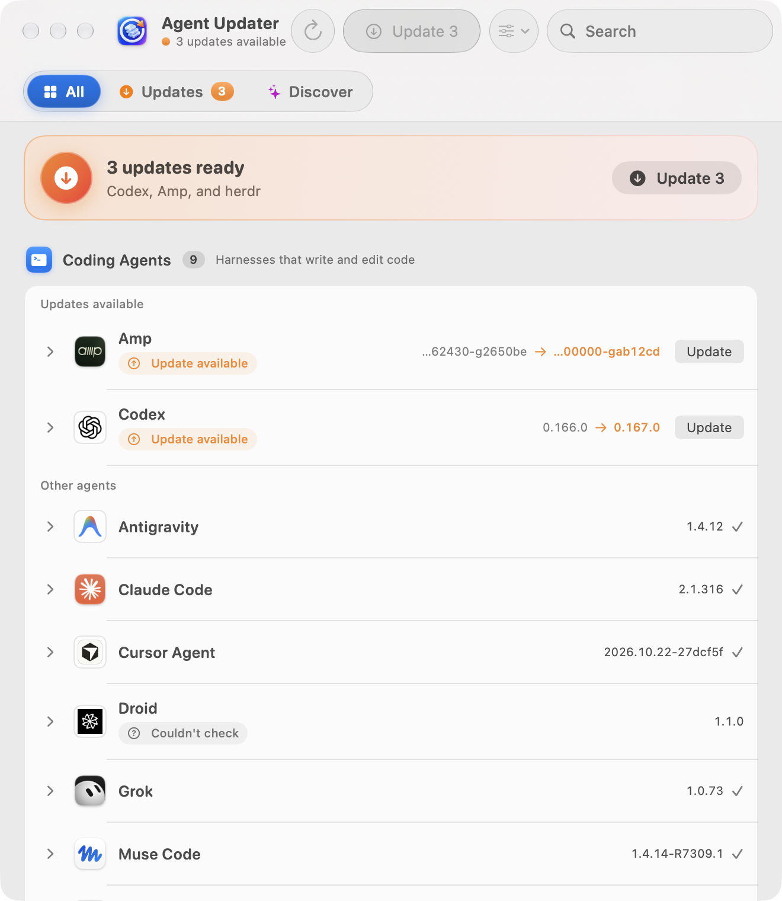
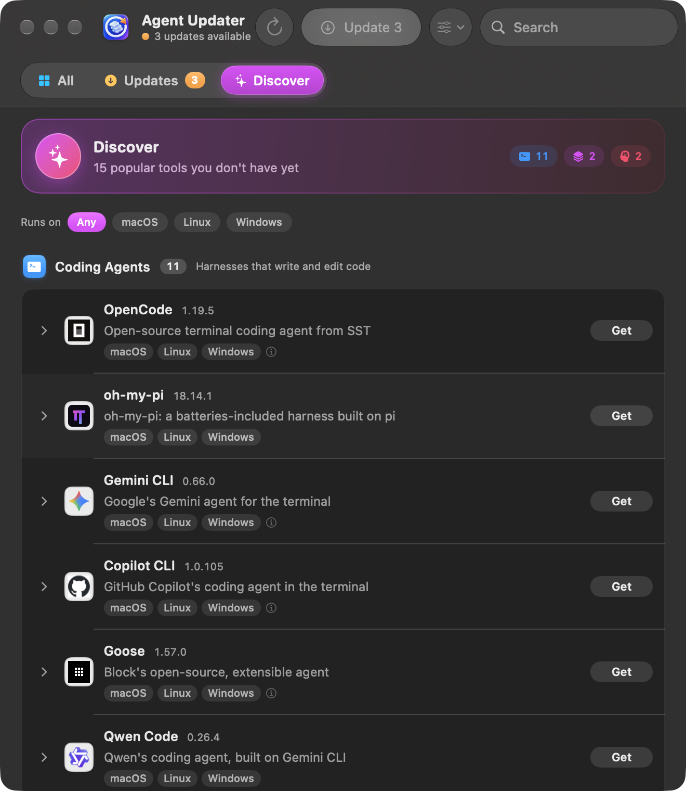
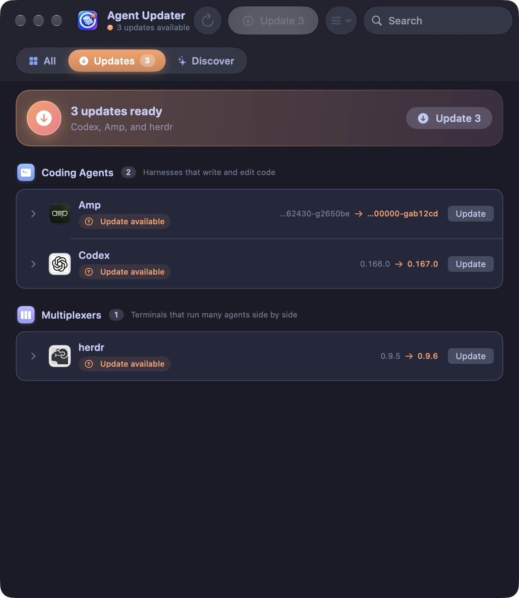

# Agent Updater

A Mac app (and a command-line tool) that keeps your AI coding agents up to date. It finds the
agents, ADEs, multiplexers, orchestrators and agent systems on your Mac, checks each one against
its latest release, and updates only the ones that are behind, one at a time.

<p align="center">
  
  
  
</p>

## What it does

- **Checks every tool against its real release channel:** npm, Homebrew, PyPI, GitHub releases,
  vendor update feeds and Sparkle appcasts. Version logic lives in one place, the `update-agents`
  script.
- **Updates only what's behind**, one at a time, with progress, Retry, Cancel and logs. You can
  pin a tool to keep it off Update All.
- **Discover** lists 50+ popular agents, ADEs, multiplexers and orchestrators you don't have yet,
  with the operating systems each one runs on. Every install confirms the exact command first.
- **Uninstall** moves program files to the Trash, or runs the package manager's uninstall. It
  never touches your settings or history.
- **Mac niceties:** a menu bar icon with the update count (or menu-bar-only mode), notifications,
  sound effects, background checks, optional automatic updates, 12 color themes (Tokyo Night,
  Catppuccin, Dracula, Nord, …), compact or regular layout, and search with ⌘F.

Covered out of the box: Claude Code, Codex, Amp, Cursor Agent, Droid, Grok, Pi, Antigravity,
Muse Code, OpenCode, Gemini CLI, Copilot CLI, Goose, Aider, T3 Code, Orca, Conductor, Zed, Warp,
herdr, Rex, cmux, Grok Bot, Muse and many more.

## Requirements

- **macOS 26 (Tahoe) or later.** The app uses Liquid Glass.
- To build from source: Xcode 27 or the matching Command Line Tools (Swift 6.2+).
- `jq` and `curl` (both ship with macOS).

## Install

### Option 1: build from source (recommended, no security prompt)

```sh
git clone https://github.com/BlockedPath/agent-updater.git
cd agent-updater
./build.sh --open        # builds, installs to ~/Applications, and opens it
```

An app you build yourself isn't quarantined, so macOS opens it without a warning.

### Option 2: download the release

1. Download `Agent-Updater-<version>.zip` from
   [Releases](https://github.com/BlockedPath/agent-updater/releases) and unzip it.
2. Move **Agent Updater.app** to Applications.
3. The app is signed but not notarized by Apple, so the first launch is blocked. Open
   **System Settings → Privacy & Security** and click **Open Anyway**. Or run:

   ```sh
   xattr -dr com.apple.quarantine "/Applications/Agent Updater.app"
   ```

## Command line

The app bundles the `update-agents` script. To use it from Terminal, open **Settings → Advanced
→ Install Command-Line Tool**, or link it yourself:

```sh
ln -s "/Applications/Agent Updater.app/Contents/Resources/update-agents" ~/.local/bin/update-agents
```

```sh
update-agents                 # show installed vs latest, then update what's behind
update-agents --list          # full table, plus popular tools you don't have
update-agents --all           # run every updater, even for tools that look current
update-agents --install NAME  # install from the popular list (asks first)
update-agents --uninstall NAME [--dry-run]
update-agents --json          # machine-readable (what the app uses)
```

## Adding a tool

Everything is data in `update-agents`:

- `AGENTS`: command-line tools to detect, and how each one updates itself.
- `CATALOG`: installable tools for Discover, as `name|install command|homepage|description`.
- `SYSTEMS`: desktop apps, tracked by app bundle and Sparkle feed.
- `kind_of`: which group a tool belongs to.
- `agent-platforms.json`: the operating systems each tool runs on, with a source link for each.

Pull requests are welcome.

## Development

```sh
./build.sh --bundle-only     # build .build/app without installing
./build.sh --release         # zip a release into dist/
./review/live.sh             # capture the real window in every theme, layout and tab (test data)
./review/live.sh lifecycle   # scripted Update All / install / uninstall run
```

## License

MIT
